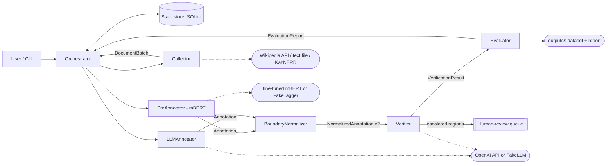

# kazner-agents

A multi-agent AI system that produces **word-level named-entity annotations for Kazakh text**
(IOB2, the 25 entity types of KazNERD). Course project for *Artificial Intelligence and Machine
Learning*; it supports an MSc thesis on adapting language models to Kazakh, where it builds an
out-of-domain evaluation set and measures LLM-based NER against a fine-tuned mBERT.

Current stage: **Assignment 4** — the full system: six agents and the orchestrator work together,
a fine-tuned mBERT and an LLM annotate independently, a Verifier settles their disagreements,
and an Evaluator scores the result against KazNERD gold labels. The full specification is in
[DESIGN.md](DESIGN.md) (Assignment 4 decisions: section 11).

## Why a team of agents

1. **Generation and verification are separated.** LLMs hallucinate and do not reliably catch
   their own errors; professional annotation uses independent annotators and a reviewer.
2. **Different knowledge sources** (fine-tuned mBERT, a general LLM, rules) fail in different ways;
   keeping them in separate agents shows where each decision came from.
3. **Human control.** Doubtful sentences go to a human-review list instead of being decided
   silently (UNESCO principle of human oversight).
4. **Replaceability.** Every annotator sits behind the same message interface, so the thesis can
   swap the LLM or the encoder and compare them under identical conditions.

## Architecture

Orchestrator (hub-and-spoke) + per-batch pipeline + shared state store (SQLite). Every message
physically passes through the Orchestrator, which looks up the recipients in a routing table
built from the run plan, checks the limits and the loop protection, saves and logs the message,
and delivers it.



A batch goes to both annotators at once. The Verifier waits for both normalised annotations,
accepts the entities they agree on, settles simple disagreements with a guideline rule and the
rest with one LLM call per batch, and sends what it cannot settle to the human-review queue.
After the last batch the Orchestrator asks the Evaluator for the report on the whole run. With
one annotator (`--annotators llm`) the Verifier is skipped, as in Assignment 2.

## Agents

| Agent | Role | Input → Output | Tools |
|---|---|---|---|
| Orchestrator | Plan the run, route messages, enforce limits | CollectRequest → RunSummary | state store |
| Collector | Fetch text, split into sentences and words, record provenance | CollectRequest → DocumentBatch | Wikipedia API; file reader; KazNERD reader; sentence/word splitter |
| PreAnnotator | Label words with the fine-tuned mBERT | DocumentBatch → Annotation (IOB2) | mBERT inference |
| LLMAnnotator | Label entities with an LLM using few-shot KazNERD examples | DocumentBatch → Annotation (spans) | LLM; few-shot example store |
| BoundaryNormalizer | Spans → word-level IOB2; repair invalid spans/sequences; validate | Annotation → NormalizedAnnotation | IOB2 validator; label set |
| Verifier | Compare the two annotations; agree, adjudicate or escalate | 2 × NormalizedAnnotation → VerificationResult | LLM (adjudication); guideline rules; human-review queue |
| Evaluator | Gold / agreement / summary scores; export the dataset; run report | VerificationResult, ReportRequest → EvaluationReport | state store; file exporter; seqeval scorer (as in kazner) |

The full table with completion criteria is generated from the code:
[docs/agents.md](docs/agents.md). All message formats, field by field, and the routing table:
[docs/messages.md](docs/messages.md).

### Message example

A real message from the example run (`gpt-6-luna`; one sentence of the batch shown):

```json
{
  "msg_id": "b230a1c1-b2e0-4edd-bd76-67e6ab2024de",
  "run_id": "20261008-124721-a6da", "step": 2,
  "sender": "LLMAnnotator", "recipient": "BoundaryNormalizer",
  "type": "Annotation", "created_at": "2026-10-08T07:47:40.105506Z",
  "payload": {
    "batch_id": "b001", "annotator": "llm",
    "sentences": [{
      "sentence_id": "kkwiki-абай-құнанбайұлы-s0007",
      "words": ["Патша", "өкіметі", "XIX", "ғасырдың", "ортасындағы", "бір", "сайлауда", "оны",
                "Қарқаралы", "ауданының", "аға", "сұлтандығына", "бекіткен", "."],
      "entities": [
        {"start_word": 2, "end_word": 3, "type": "DATE", "text": "XIX ғасырдың"},
        {"start_word": 8, "end_word": 9, "type": "GPE", "text": "Қарқаралы ауданының"},
        {"start_word": 10, "end_word": 11, "type": "POSITION", "text": "аға сұлтандығына"}
      ],
      "labels": null, "notes": []
    }]
  }
}
```

## Setup (Windows PowerShell)

Requires Python 3.11.

```powershell
py -3.11 -m venv .venv
.venv\Scripts\Activate.ps1
pip install -e ".[dev]"
# for the real mBERT (the CPU build of torch is enough for inference):
pip install torch --index-url https://download.pytorch.org/whl/cpu
pip install -e ".[mbert]"
```

To use the real OpenAI model, copy `.env.example` to `.env` and put your key in it. `.env` is
gitignored; the key is never printed or logged. `KNA_KAZNERD_DIR` and `KNA_MBERT_PATH` point to
the KazNERD files and the fine-tuned mBERT (defaults: the pilot project next to this one).
Without them everything still works offline with FakeLLM and FakeTagger.

## Usage

```powershell
# The typical scenario: a KazNERD test sample with gold labels, mBERT + LLM, scored against gold
kna run --source kaznerd_test --max-sentences 20 --batch-size 10 --llm openai

# A Wikipedia article (no gold): the run reports how much mBERT and the LLM agree
kna run --source wikipedia --title "Абай Құнанбайұлы" --max-sentences 20 --llm openai

# Fully offline, no cost: FakeLLM and FakeTagger (crude heuristics, NOT real NER)
kna run --source file --path scenarios/fixtures/abai.txt --llm fake --tagger fake

# One annotator only (the Assignment 2 pipeline, no Verifier)
kna run --source wikipedia --title "Алматы" --annotators llm --llm openai

kna review <run_id>        # the human-review queue of a run
kna scenarios              # the 11 test scenarios, offline, pass/fail
kna load-report latest     # each agent's share of LLM + tool calls; exit 1 if any is over 40%
kna docs                   # regenerate docs/agents.md and docs/messages.md from the code
```

A run writes:

- `outputs/<run_id>/annotations.iob2`: the final labels in KazNERD format;
- `outputs/<run_id>/sentences.jsonl`: per sentence the final labels, the gold labels (if any),
  each annotator's labels, the Verifier's decisions and the provenance (source URL, licence);
- `outputs/<run_id>/review.jsonl`: sentences a person should check, with the reasons;
- `outputs/<run_id>/report.json` and `report.md`: the run report (scores over all sentences);
- `logs/<run_id>.jsonl`: one record per message, tool call and LLM call (metadata only);
- `state/kna.sqlite3`: runs, batch statuses, every delivered message and the review queue.

### Example run (typical scenario)

20 sentences sampled from the KazNERD test split, 2 batches, mBERT + gpt-6-luna. Log, load
report and run report: [docs/example-run/](docs/example-run/).

```text
run 20261106-101402-60cb: completed
annotators: mbert, llm
steps: 19, sentences: 20, entities: 24, sentences for review: 0
verifier decisions: adjudicated 2, agreed 23
gold F1  final 0.980  (P 1.000, R 0.960)
gold F1  llm   0.939  (P 0.958, R 0.920)
gold F1  mbert 1.000  (P 1.000, R 1.000)
LLM: 4 calls to gpt-6-luna, tokens in/out: 9470/1549, estimated cost: $0.0017

Agent                 LLM  Tool  Total   Share
Evaluator               0     6      6   24.0%
BoundaryNormalizer      0     4      4   16.0%
Orchestrator            0     4      4   16.0%
Verifier                2     2      4   16.0%
LLMAnnotator            2     1      3   12.0%
PreAnnotator            0     3      3   12.0%
Collector               0     1      1    4.0%
Total                   4    21     25

OK: no agent over the limit
```

On KazNERD's own domain the fine-tuned mBERT is near perfect, and one of the two LLM
adjudications made the final labels worse: the LLM judged «Бір-екеуі» ("one or two of them")
not an entity, while KazNERD labels it CARDINAL. On a 200-sentence KazNERD sample: mBERT F1 0.945, LLM 0.773, final
after the Verifier 0.908 — the LLM adjudicator follows meaning rather than KazNERD's conventions.
All real runs, including Wikipedia articles with annotator agreement, and what they revealed:
[docs/real-runs.md](docs/real-runs.md).

## Test scenarios

`scenarios/*.json` describe a run and its expected results; `kna scenarios` and pytest run them
offline (FakeLLM, FakeTagger, a fake Wikipedia serving a fixture text).

| # | Scenario | Expected result |
|---|---|---|
| 01 | Gold sample, mBERT + LLM | completed; gold scores for final, mbert, llm; agreed, adjudicated and escalated decisions; review queue filled; no agent over 40% |
| 02 | Wikipedia article, two annotators | completed; agreement mode with an agreement score |
| 03 | Local file, LLM only | completed; summary mode; Verifier and PreAnnotator idle |
| 04 | Gold sample, mBERT only | completed; gold scores for mbert; no LLM work |
| 05 | Missing Wikipedia article | failed at once with "no article titled …" |
| 06 | LLM fails twice | completed; the log shows 3 attempts in one call |
| 07 | LLM fails 4 times in a row | that batch failed (TransientError), the next one done |
| 08 | Adjudication call fails | completed; open regions escalated to the review queue |
| 09 | Annotator sends the batch to itself | third delivery rejected; batch failed with LoopDetected |
| 10 | Step limit too low | stopped; batches done / failed / skipped |
| 11 | LLM call cap reached | stopped with "LLM call limit" |

## How the LLM is used

- Model: `gpt-6-luna` with reasoning effort `low`, configurable in `.env`. It was chosen as an
  inexpensive current OpenAI model with Structured Outputs. Measured in the example run: about
  4.3k input and 1.2k output tokens, $0.001 and 8–18 s per batch of 10 sentences.
- Annotation: one call per batch through the Responses API with **Structured Outputs**: the answer must match a
  strict JSON schema (entity type is an enum of the 25 KazNERD labels).
- The prompt follows the structure from the lecture on prompt engineering: *Role, Task, Context
  (25 entity types with short descriptions), numbered Steps, few-shot Examples, Output format*,
  with delimiters (`<sentences>…</sentence>`).
- Few-shot: 23 short KazNERD training sentences that together cover all 25 types, selected
  deterministically by [scripts/select_fewshot.py](scripts/select_fewshot.py).
- LLMs miscount word indices, so every word is shown with its index (`0:Абай 1:Шығыс …`) and the
  model also returns the span text. The BoundaryNormalizer moves or drops spans whose text does
  not match and sends those sentences to the review list.
- Adjudication (Verifier): one call per batch for all open disagreement regions. The two
  versions are shown as "A" and "B" without saying which annotator wrote them, so the LLM does
  not simply prefer its own; it may answer "unsure", which sends the region to a person.

## Reliability and safety

- **Limits** (in `.env`): max 150 steps (delivered messages) per run, 900 s per run, 60 s per LLM
  call, 40 LLM calls per run. Every attempt counts towards the LLM cap. A batch takes 9 messages
  and up to 2 LLM calls.
- **Loop protection**: the same `(batch, message type, sender, recipient)` is delivered at most
  twice; the third time it is rejected and the batch fails.
- **Errors**: network and API calls are retried 3 times with exponential backoff (1 s, 2 s, 4 s);
  the OpenAI SDK's own retries are off. A failed batch is marked `failed` with a readable reason and
  the run continues; a limit stops the run and the remaining batches are marked `skipped`.
  A failed adjudication does not fail the batch: its regions are escalated to the review queue.
- **Logging**: every message, tool call and LLM call (with token counts) goes to
  `logs/<run_id>.jsonl`. Records hold metadata only, never the annotated text.
- **Keys** only in `.env` (gitignored). **One LLM client** ([llm.py](src/kazner_agents/llm.py))
  for every call; a deterministic **FakeLLM** for tests and demos.

## Responsible AI

- **Human oversight** (UNESCO Recommendation on the Ethics of AI, 2021): doubtful sentences are
  listed for a person to review, not silently decided; the Verifier escalates the disagreements
  it cannot settle to a review queue (`kna review <run_id>`).
- **Transparency**: every decision is traceable in the log; repairs are written in plain words.
- **Data provenance and licences**: every sentence keeps its source URL and licence. Kazakh
  Wikipedia is CC BY-SA 4.0; KazNERD is CC BY 4.0. Logs contain no text, so they can be shared.
- **Privacy**: few-shot examples with phone-number-like tokens are excluded.
- Context: the Law of the Republic of Kazakhstan No. 230-VIII "On Artificial Intelligence" (in
  force since 18 January 2026) requires safety, transparency and accountability of AI systems.

## Tests

```powershell
pytest
```

90 tests, offline (FakeLLM, FakeTagger, no network, no model), about 5 seconds. Covered: message
schema validation; span → IOB2 conversion and repair; Kazakh sentence/word splitting; the
Verifier's regions, rule, adjudication and escalation; scoring identical to the `kazner`
evaluator; orchestrator limits, loop protection and failure handling; LLM client retries with a
fake that fails N times; the load report; the CLI; all 11 scenarios; generated docs up to date.

## Project layout

```text
src/kazner_agents/
  messages.py        envelope + all payload models (pydantic)
  orchestrator.py    routing table, limits, loop protection, run_pipeline()
  agents/            specs.py (agent table), collector, pre_annotator, llm_annotator,
                     normalizer, verifier, evaluator
  metrics.py         seqeval scoring (same as kazner) and annotator agreement
  scenarios.py       test scenario runner; fakes.py: FakeLLM answers and FakeTagger
  llm.py             LLMClient, OpenAIBackend, FakeLLM
  iob2.py            spans → IOB2, repair, validation
  text_split.py      Kazakh sentence/word splitter (KazNERD tokenisation)
  wikipedia.py       Kazakh Wikipedia API tool
  state.py           SQLite state store
  run_log.py         JSONL run log
  load_report.py     per-agent share of calls
  docs_gen.py        generates docs/agents.md and docs/messages.md
  cli.py             `kna` command
  data/fewshot_kaznerd.jsonl
scenarios/          11 scenario files + synthetic fixtures
scripts/select_fewshot.py
tests/
```

## Scope by stage

- **Assignment 2:** architecture, specification, four agents and the orchestrator end to end.
- **Assignment 4 (this version):** PreAnnotator (fine-tuned mBERT), Verifier with rule, LLM
  adjudication and escalation, Evaluator gold/agreement modes and run report, the `kaznerd_test`
  source, 11 test scenarios with expected results.
- **Exam:** 10+ scenarios with measured F1 and agreement, report and slides.

## Data and licences

Links, versions, checksums and how each dataset is used: [DATASET.md](DATASET.md).

KazNERD: R. Yeshpanov, Y. Khassanov, H. A. Varol. *KazNERD: Kazakh Named Entity Recognition
Dataset.* LREC 2022. CC BY 4.0, <https://github.com/IS2AI/KazNERD>. The few-shot file contains
23 sentences from its training split. Text fetched from Kazakh Wikipedia is CC BY-SA 4.0.
